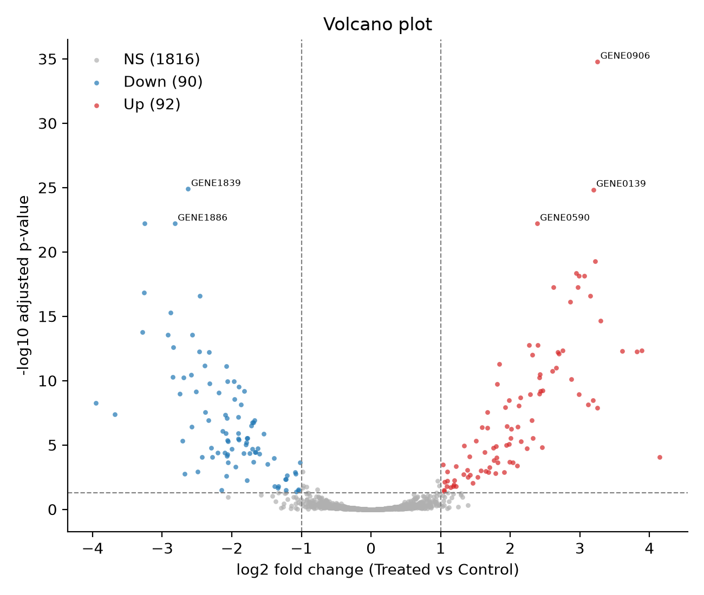
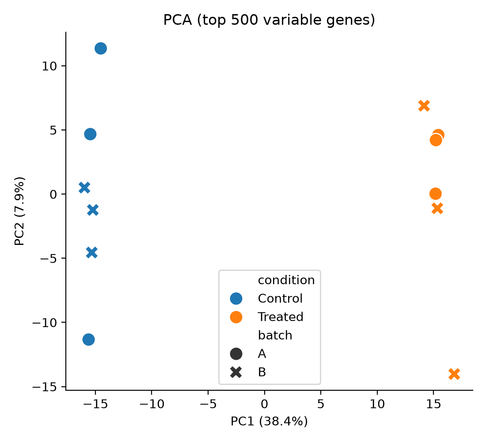
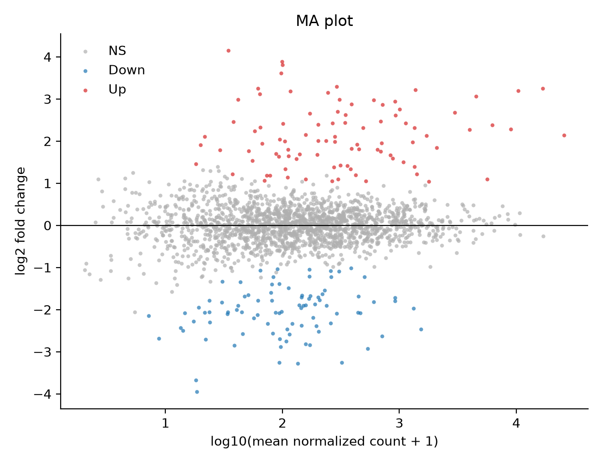
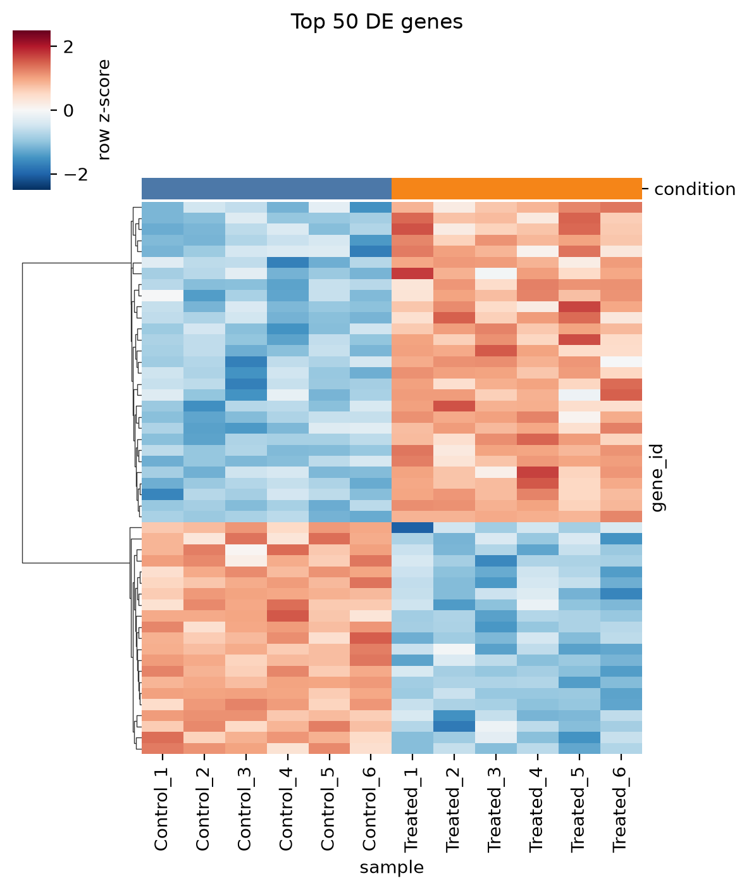

# 🧬 RNA-seq Explorer

[](https://github.com/your_github_username/rnaseq-explorer/actions)
[](https://YOUR-APP-NAME.streamlit.app)


An interactive web app for **bulk RNA-seq differential expression analysis**. Upload a raw count matrix and sample sheet, run **PyDESeq2** (a Python re-implementation of DESeq2), and explore the results through linked, filterable **volcano, MA, PCA and heatmap** plots, with one-click CSV export.

**🔗 Live demo:** https://YOUR-APP-NAME.streamlit.app *(replace after deploying; see [Deployment](#deployment))*



## Why this project?

Differential expression is the most common first analysis in transcriptomics, but wet-lab collaborators often depend on a bioinformatician to re-run it for every new threshold or gene of interest. This app makes the analysis **reproducible, parameter-transparent and self-service**, while the code underneath stays testable and scriptable.

## Features

| Feature | Details |
|---|---|
| Input validation | Rejects non-integer (TPM/FPKM) data, duplicate genes, mismatched sample names, groups with < 2 replicates, with readable error messages |
| Flexible design | Pick condition column, reference/test level, and **covariates** (e.g. `~ batch + condition`) |
| DE engine | PyDESeq2: median-of-ratios normalization, dispersion trend fitting, Wald test, BH correction, optional apeGLM LFC shrinkage |
| Interactive volcano | Live p-value / log2FC sliders, hover details, **box/lasso selection to extract gene lists** |
| PCA | Choose number of top variable genes, colour and shape by any metadata column (spot batch effects) |
| Heatmap | Clustered row z-scores of top-N genes, ordered by condition |
| Gene lookup | Per-gene boxplot with sample-level points and stats |
| Export | DE table, normalized counts, selected genes |
| Headless mode | `scripts/run_pipeline.py` reproduces everything without the UI |
| Tested | pytest suite (including a recovery test against simulated ground truth) + GitHub Actions CI |

## Data

Included in `data/` (generated by `scripts/generate_demo_data.py`, seed 42):

| File | Content |
|---|---|
| `demo_counts.csv` | 2,000 genes × 12 samples, raw integer counts |
| `demo_metadata.csv` | `condition` (Control/Treated, n = 6 each) and `batch` (A/B, balanced) |
| `demo_ground_truth.csv` | True log2FC per gene (200 truly DE: 100 up, 100 down; |log2FC| 1 to 3) |

> ⚠️ **The bundled dataset is simulated** (negative binomial counts with gene-wise dispersion, library-size variation and a batch effect on ~15% of genes). It is used because the true answer is known, which allows a quantitative validation of the pipeline. See [Using real data](#using-real-data) to run it on public datasets.

### Input format

Counts (genes × samples, first column = gene ID):
```
gene_id,Control_1,Control_2,...,Treated_1,...
GENE0001,191,278,...,4,...
```
Metadata (first column = sample ID, matching the count columns):
```
sample,condition,batch
Control_1,Control,A
```

## Results on the demo data

Command (`--covariates batch` fits design `~ condition + batch`):
```bash
python scripts/run_pipeline.py --covariates batch
```

**Significance thresholds:** adjusted p < 0.05 and |log2FC| ≥ 1.

| Metric | Value |
|---|---|
| Genes tested (after filtering ≥ 10 reads) | 1,998 / 2,000 |
| Up-regulated in Treated | **92** |
| Down-regulated in Treated | **90** |
| PC1 / PC2 variance | 38.4% / 7.9% |

### Validation against ground truth

| Metric | Value |
|---|---|
| True positives / False positives / False negatives | 171 / 11 / 29 |
| Precision | **0.940** |
| Recall (sensitivity) | **0.855** |
| Observed FDR (nominal 5%) | 6.0% |
| Direction (sign) of log2FC correct | **100%** of true positives |
| Pearson r (estimated vs true log2FC) | **0.981** |

Missed genes are mostly low-expression genes with small true fold changes, where power is limited with n = 6 per group. This is expected behaviour, not a bug.

### Figures

| PCA | MA plot |
|---|---|
|  |  |



Static figures are in `results/`. Standalone **interactive** versions (open in any browser): `docs/volcano_interactive.html`, `docs/pca_interactive.html`, `docs/heatmap_interactive.html`.

Top hits (`results/de_results.csv`):

| gene_id | baseMean | log2FC | padj |
|---|---|---|---|
| GENE0906 | 16849 | +3.25 | 1.7e-35 |
| GENE1839 | 710 | −2.63 | 1.3e-25 |
| GENE0139 | 10362 | +3.19 | 1.4e-25 |

## Quick start

```bash
git clone https://github.com/your_github_username/rnaseq-explorer.git
cd rnaseq-explorer

# option A: pip
python -m venv .venv && source .venv/bin/activate
pip install -r requirements.txt

# option B: conda
conda env create -f environment.yml && conda activate rnaseq-explorer

# option C: Docker
docker build -t rnaseq-explorer . && docker run -p 8501:8501 rnaseq-explorer
```

Run the app:
```bash
streamlit run app.py        # opens http://localhost:8501
```
Run the tests:
```bash
pytest -q
```

## Repository structure

```
rnaseq-explorer/
├── app.py                      # Streamlit UI
├── src/rnaseq_explorer/
│   ├── io.py                   # loading + validation
│   ├── de.py                   # PyDESeq2 wrapper, PCA, classification
│   ├── plots.py                # interactive Plotly figures
│   └── static.py               # matplotlib figures for README/CLI
├── scripts/
│   ├── generate_demo_data.py   # simulated dataset with ground truth
│   └── run_pipeline.py         # headless analysis + validation
├── data/                       # demo counts, metadata, ground truth
├── results/                    # tables, PNGs, summary.json
├── docs/                       # interactive HTML exports
├── tests/test_pipeline.py
├── .github/workflows/ci.yml
├── Dockerfile  environment.yml  requirements.txt  pyproject.toml
```

## Methods

1. **Filtering:** genes with fewer than 10 total reads are removed.
2. **Normalization:** median-of-ratios size factors (DESeq2).
3. **Dispersion:** gene-wise estimates, parametric trend, empirical Bayes shrinkage.
4. **Testing:** Wald test for the contrast `test vs reference`; Benjamini-Hochberg adjusted p-values (with independent filtering as in PyDESeq2).
5. **Visualization:** log2(normalized count + 1); PCA on the top-N most variable genes (mean-centred); heatmap uses row z-scores with average-linkage, correlation-distance clustering.

Reference: Muzellec B. *et al.* **PyDESeq2: a python package for bulk RNA-seq differential expression analysis.** *Bioinformatics* 39(9), 2023. Love M.I. *et al.* **Moderated estimation of fold change and dispersion for RNA-seq data with DESeq2.** *Genome Biology* 15, 550 (2014).

## Using real data

1. Get raw counts, for example from a GEO series' supplementary files (`GSExxxxx_raw_counts.txt`), `featureCounts`/`HTSeq` output, or the [recount3](https://rna.recount.bio/) project.
2. Make sure values are **raw integer counts** (not TPM/FPKM).
3. Build a metadata sheet with one row per sample.
4. Upload both in the app, or run:
```bash
python scripts/run_pipeline.py --counts my_counts.csv --metadata my_meta.csv \
    --condition treatment --reference untreated --test drugX --covariates batch --truth ""
```
Good teaching datasets: the **airway** dataset (dexamethasone-treated airway smooth muscle cells, GEO GSE52778) or the **pasilla** knockdown dataset. Adding a real-data case study to this repo is a strong next step (see Roadmap).

## Deployment

**Streamlit Community Cloud (free):**
1. Push this repo to GitHub (public).
2. Go to <https://share.streamlit.io>, sign in with GitHub, click **New app**.
3. Select the repo, branch `main`, main file `app.py`. Deploy.
4. Copy the URL into the badge and "Live demo" link at the top of this README.

Alternatives: Hugging Face Spaces (Streamlit SDK) or any host that runs the provided Dockerfile.

## Limitations

- Designed for **bulk** RNA-seq with a modest number of samples; very large matrices (> 50 MB) may be slow in a free-tier deployment.
- Simple linear designs only (one condition + additive covariates); no interaction terms or likelihood-ratio tests yet.
- Gene IDs are displayed as given; no annotation (symbols, GO) is added.
- The demo is simulated; performance on real data depends on biology and experimental design.

## Roadmap

- [ ] Real-data case study (airway) with biological interpretation
- [ ] Gene set enrichment / over-representation (GSEApy)
- [ ] Gene ID to symbol mapping (MyGene.info / Ensembl BioMart)
- [ ] Interaction terms and multi-level contrasts
- [ ] Sample outlier detection (Cook's distance, sample correlation heatmap)
- [ ] Export a self-contained HTML report

## Citation

If you use this tool, please cite the repository and the PyDESeq2 paper above.

## License

MIT, see [LICENSE](LICENSE).
